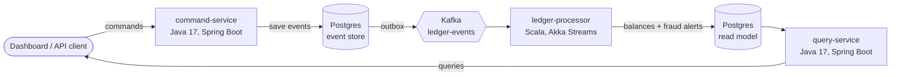

# Event-Sourced Payments Ledger

I built this project to learn and practice how banking back-end systems handle money.
It is a small payments ledger split into three services, written in Java and Scala,
connected through Kafka.

You can open accounts, deposit, withdraw and transfer money. I never update a balance
directly. Instead I save every change as an event (like "100.00 deposited") and work out
the balance from those events. A Scala service reads the events from Kafka, builds the
data the dashboard shows, and flags payments that look suspicious.



## What I used and where

| Topic | What I did |
|---|---|
| Core Java | Java 17 records and sealed interfaces, an account model that never changes in place, money kept as whole cents, safe handling of two requests hitting the same account |
| Scala and functional programming | Akka Streams to read from Kafka, pure functions for the balance and fraud logic, circe to read JSON, cats `Validated` to collect all errors at once, cats `CommutativeGroup` for the fraud window |
| DDD, CQRS, event sourcing | One service writes events, another serves reads. The read data can be deleted and rebuilt from Kafka at any time |
| Kafka | Events keyed by account so each account stays in order, duplicates skipped on the consumer side, bad messages saved to a dead letters table |
| Data structures and algorithms | A sliding time window that updates in constant time, request fingerprints for safe retries, version numbers to spot duplicates and missing events |
| REST APIs | Clear URLs, an `Idempotency-Key` header so a retry never charges twice, proper status codes and error bodies, Swagger docs |
| Testing | JUnit 5, MockMvc, Cucumber (BDD) scenarios, ScalaTest, property-based tests, and Testcontainers integration tests against real Postgres and Kafka |
| CI | GitHub Actions builds and tests each service, then starts everything with Docker and runs an end-to-end test |
| Linux and DevOps | Dockerfiles, Docker Compose, Bash scripts, and an Ansible playbook to deploy on a Linux server |
| Production support | Health checks, JSON logs, simple metrics, and a [runbook](docs/RUNBOOK.md) for on-call |
| Web | A small AngularJS and Bootstrap dashboard |
| Python | A load test script that also checks no money was created or lost |

## How to run it

You only need Docker. (JDK 17+, Maven and sbt are only needed to run the tests outside Docker.)

```bash
./scripts/run-local.sh      # builds and starts Postgres, Kafka and the 3 services
./scripts/smoke-test.sh     # runs end-to-end checks through all services
```

| URL | What it is |
|---|---|
| http://localhost:8082 | Dashboard |
| http://localhost:8081/swagger-ui.html | Command API docs |
| http://localhost:8082/swagger-ui.html | Query API docs |
| http://localhost:8083/metrics | Processor counters |

Other things you can run:

```bash
python3 scripts/load_gen.py --accounts 20 --transfers 500   # load test + money check
./scripts/replay-projections.sh                              # rebuild the read data from Kafka
make test                                                    # all tests
```

## API

Command side (`localhost:8081/api/v1`):

| Method | Path | Result |
|---|---|---|
| POST | `/accounts` with `{owner, currency, initialDeposit}` | 201 with the new account id |
| POST | `/accounts/{id}/deposits` with `{amount, reference}` | 202 |
| POST | `/accounts/{id}/withdrawals` with `{amount, reference}` | 202, or 422 if there is not enough money |
| POST | `/transfers` with `{fromAccountId, toAccountId, amount}` | 202, or 422 with a reason code |
| GET | `/accounts/{id}/events` | Every event for the account (audit trail) |
| GET | `/accounts/{id}/state` | Balance worked out right now from the events |

Every POST accepts an `Idempotency-Key` header. If a client sends the same request again
with the same key, it gets the first answer back and no money moves a second time.

Query side (`localhost:8082/api/v1`): `GET /accounts`, `/accounts/{id}`,
`/accounts/{id}/transactions`, `/alerts`, `/summary`.

```bash
curl -s -X POST localhost:8081/api/v1/accounts -H 'Content-Type: application/json' \
  -d '{"owner":"Alice","currency":"USD","initialDeposit":100.00}'

curl -s -X POST localhost:8081/api/v1/transfers -H 'Content-Type: application/json' \
  -H 'Idempotency-Key: 3f0c...' -d '{"fromAccountId":"...","toAccountId":"...","amount":150.00}'
# {"title":"INSUFFICIENT_FUNDS","status":422,"detail":"Balance 100.00 is less than 150.00","code":"INSUFFICIENT_FUNDS"}
```

## BDD scenarios

I wrote the main business rules as Cucumber scenarios in
[`command-service/src/test/resources/features`](command-service/src/test/resources/features).
They run with `mvn test`:

```gherkin
Scenario: A transfer larger than the balance is rejected
  Given "Alice" has a "USD" account with a balance of 100.00
  And "Bob" has a "USD" account with a balance of 20.00
  When "Alice" transfers 150.00 to "Bob"
  Then the transfer is rejected with "INSUFFICIENT_FUNDS"
  And "Alice" has a balance of 100.00
```

## Folder layout

```
command-service/     Java - takes commands, saves events, sends them to Kafka
ledger-processor/    Scala - reads Kafka, builds balances, runs fraud rules
query-service/       Java - read API and the dashboard (in static/)
infra/               Postgres setup
scripts/             Bash scripts and the Python load test
deploy/ansible/      Ansible playbook for a Linux server
docs/                Architecture, event format, runbook
.github/workflows/   CI pipeline
```

## Things I paid attention to

More detail is in [docs/ARCHITECTURE.md](docs/ARCHITECTURE.md). The short version:

- **No money lost or doubled.** Each account event has a version number and the database
  will not accept two events with the same version. If two requests race, one retries and
  checks the balance again. I have a test that fires 20 withdrawals at once at one account
  and it never goes below zero. A transfer saves the debit and the credit together.
- **No half-sent events.** The command service only writes to Postgres. A separate job then
  sends saved events to Kafka in order (the outbox pattern), so the database and Kafka can't
  disagree.
- **Duplicates are safe.** Kafka can deliver a message twice. The processor only applies an
  event if its version is the next one for that account, so a repeat is simply skipped.
- **Fraud checks give the same answer on replay.** The rules use the time stored in each
  event, not the current clock, and each alert id is built from the rule and the event, so
  replaying never creates extra alerts.

### A bug I found under load

My first load test showed a few server errors. The logs showed a Postgres deadlock: a
transfer from A to B and one from B to A at the same time each waited for the other. I fixed
it by always saving events in the same account order, and by retrying with a short random
wait. After the fix, two runs of 500 transfers had no errors and the totals matched exactly.

To keep it fixed, I added an integration test (`JdbcEventStoreIT`) that runs against a real
Postgres in Docker using Testcontainers and fires 200 transfers both ways at once. I checked
that it fails when I take the fix out, and passes with it in.

## What I would add next

Snapshots so long account histories load faster, fraud alerts on their own Kafka topic,
processing Kafka partitions in parallel, and Prometheus
dashboards for lag and backlog.
