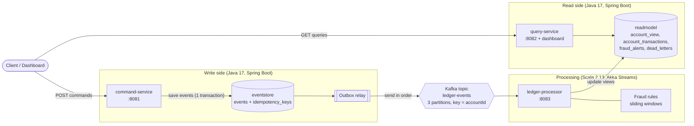

# How it works

## The big picture



## Why I chose event sourcing and CQRS

A ledger is really just a list of things that happened: money came in, money went out.
So I store those facts as events instead of keeping one balance number that keeps changing.
That gives me:

- **A full history for free.** Nothing is ever overwritten. `GET /accounts/{id}/events`
  shows every change, which is what an auditor would want.
- **Read data I can rebuild.** If a view has a bug, I fix the code, delete the view, and
  replay the events from Kafka. `scripts/replay-projections.sh` does this.
- **Reads and writes can grow separately.** Most traffic is reads (dashboards, statements),
  so the query service can be scaled or changed without touching the write side.

The cost is that the read side is a little behind. After a command returns `202 Accepted`,
the dashboard shows it a moment later (well under a second when I run it locally). If
someone needs the exact balance right now, `/accounts/{id}/state` on the command service
works it out directly from the events.

## Write side: command-service

| Topic | How I did it |
|---|---|
| Account model | `Account` never changes in place. `replay()` goes through the events to build the current state. Methods like `deposit` and `sendTransfer` check the rules and return a new event. The domain classes don't depend on Spring. |
| Money | Stored as `long` cents so there is no rounding error. `Money.of(...)` rejects zero, negatives, more than 2 decimals and unknown currencies. |
| Two requests at once | Every event has the account's next version number, and Postgres has `UNIQUE (account_id, version)`. If two requests race, only one can save version N. The other reloads, checks the balance again, and retries (up to 6 tries with a short random wait). So a race can't overdraw an account. |
| Transfers | The debit (`TransferSent`) and the credit (`TransferReceived`) are saved in one database transaction. Both accounts are in the same database, so I don't need a saga. |
| Deadlocks | I always insert events sorted by account id. Without this, A to B and B to A at the same moment could lock each other. I found this with the load test, and `JdbcEventStoreIT` now checks it against a real Postgres. |
| Safe retries | Clients can send an `Idempotency-Key` header. I store the key, a hash of the request and the result in the same transaction as the events. A retry gets the first result back. The same key with a different request gets `422 IDEMPOTENCY_KEY_REUSED`. |
| Sending to Kafka | Commands only write to Postgres. A small job (`OutboxRelay`) checks every 250 ms for events not yet sent and publishes them in order. This way I never have "saved in the DB but not sent to Kafka" or the other way round. A message can be sent twice, so the consumer has to handle duplicates. |
| Errors | Standard problem-detail JSON with a `code` field like `INSUFFICIENT_FUNDS` or `CURRENCY_MISMATCH`. |

## Kafka

- Topic `ledger-events` with 3 partitions. Retention is unlimited because this topic is the
  history I replay from.
- The message key is the account id, so all events for one account go to the same partition
  and stay in order.
- The message format is simple flat JSON, written down in [EVENTS.md](EVENTS.md). Both the
  Java and Scala sides read and write it by hand, so any change to the format shows up
  clearly in code review.

## Processing: ledger-processor (Scala)

```
read from Kafka -> parse JSON -> check fields -> update views + fraud rules (1 DB transaction) -> commit offset
       ^                                                                                              |
       +------------------------ restart with growing wait time if something fails <------------------+
```

- **Logic separate from I/O.** `AccountProjection.project` and `FraudEngine.observe` are pure
  functions: they take the current state and an event and return the new state. All the
  database and Kafka code is in `ReadModelRepository` and `LedgerStream`. This made the logic
  easy to test.
- **Skipping duplicates.** An event is applied only if its version is exactly one more than
  what the view already has. Lower means I already saw it, so I skip it. Higher means one is
  missing, so it goes to `dead_letters`.
- **Offset after the database.** I commit the Kafka offset only after the database
  transaction succeeds. If the service crashes in between, the event comes again and is
  skipped as a duplicate.
- **All errors at once.** cats `ValidatedNec` collects every problem with a bad event, so the
  dead letter row lists everything wrong with it, not just the first issue.
- **Blocking calls on their own threads.** JDBC calls run on a separate thread pool so they
  don't slow down Akka, and the stream only pulls from Kafka as fast as Postgres can keep up.

### Fraud rules

| Rule | When it fires |
|---|---|
| `LARGE_TRANSACTION` | One outgoing payment of 10,000.00 or more |
| `VELOCITY` | More than 5 outgoing payments from one account within 60 seconds |
| `VOLUME` | More than 5,000.00 going out of one account within 10 minutes |

For the time windows I wrote `SlidingWindow`: a queue of `(time, value)` pairs plus a running
total. When I add a new entry, I drop entries older than the window from the front of the
queue. Each entry goes in once and comes out once, so on average each update is constant
time, and I can read the total without adding everything up again.

To drop an entry I have to subtract it from the total. That's why `WindowStats(count, total)`
is a commutative group in cats: `combine` adds and `inverse` makes the negative. A monoid
would only let me add. `WindowStatsLawsSpec` checks the group rules with property-based
tests, and `SlidingWindowSpec` compares the window with a simple full recount over 2,000
random events.

The windows use the time stored in each event, not the current clock, so a replay gives the
same alerts. A window rule fires only on the payment that crosses the limit, not on every
payment after it. Alert ids are built from the rule name and the event id, so processing an
event twice can't create a second alert. After a restart, the engine reloads the last
10 minutes of outgoing payments so the windows aren't empty.

## Read side: query-service

Simple lookups on tables that already match what the screens need. It uses a read-only
connection pool and also serves the AngularJS dashboard.

## Choices I made

| What I picked | Other option | Why |
|---|---|---|
| Postgres as the event store | EventStoreDB, or Kafka alone | Postgres lets me save several events in one transaction and use a unique constraint to catch races. |
| Outbox with polling | Debezium (change data capture) | Polling is simple to run locally. With more traffic, Debezium on the `events` table would remove the polling delay without changing the schema. |
| Transfers in one transaction | A saga with undo steps | Both accounts are in one database. If they lived in different services, I would make it a saga: reserve, credit, confirm, and a `TransferReversed` event if something fails. |
| Akka 2.6 | Akka 2.7+, Apache Pekko | 2.6 is the last Akka version under the Apache 2.0 license. Pekko is the open source fork with the same API if I move forward. |
| Look up each account in the DB per event | Keep views in memory | Simpler and correct after restarts. A cache is the next step if I need more speed. |

## What I would add next

- Snapshots every N events so long account histories load faster.
- Fraud alerts on their own Kafka topic for other teams to consume.
- Process Kafka partitions in parallel to scale the processor.
- Prometheus metrics and dashboards for consumer lag and outbox backlog.
